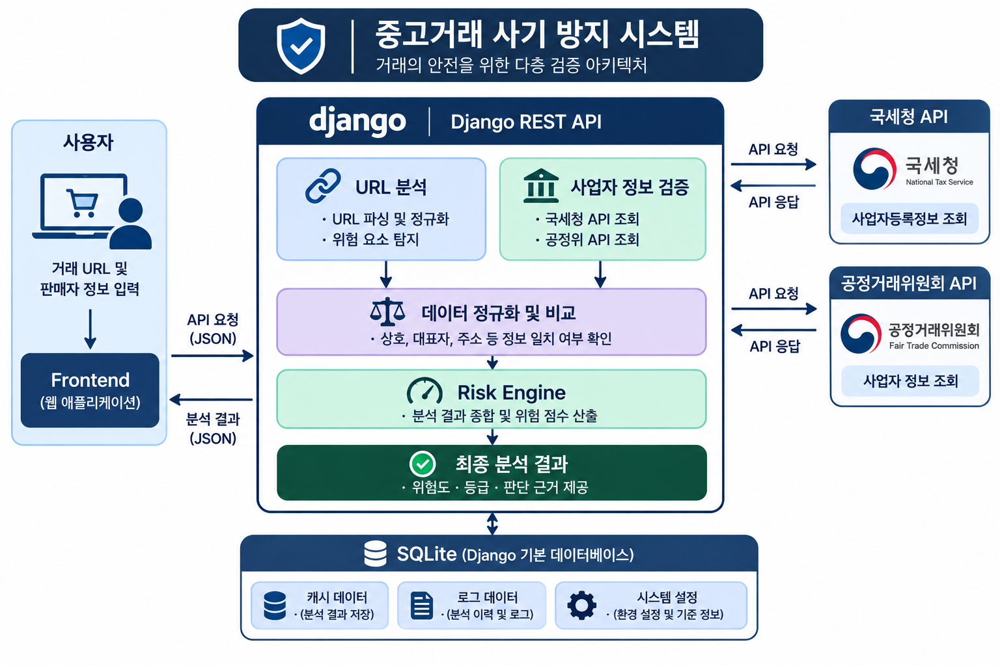

# WOOWANGTHON_TEAM_25_BE

중고거래 사기 방지 시스템

프론트에서의 정보, 외부 API의 조회, AI 정보 제공 등 일련의 흐름을 제어하는 백엔드입니다.

## 기술스택
- python
- django
- docker

## 현재 구현 범위
- 국세청, 공정거래 위원회 API 호출 및 AI url 분석
- 호출한 데이터 토대로 대조 및 점수 산출
- 사용자에게 위험도, 판단 근거 표시
  
## 아키텍쳐 다이어그램



## 로컬 실행 방법
1. FE repository(https://github.com/woowangthon/WOOWANGTHON_TEAM_25_FE#woowangthon_team_25_fe) 설명에 맞춰 chrome 플러그인을 설치합니다.
2. git clone으로 repository를 복사합니다.
3. docker desktop 실행 중 dockerfile이 있는 폴더에서 해당 커맨드를 실행합니다.
```bash
docker build -t phishing-trace .
docer run --rm -it -p 8000:8000 phishing-trace
```


